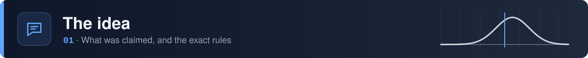
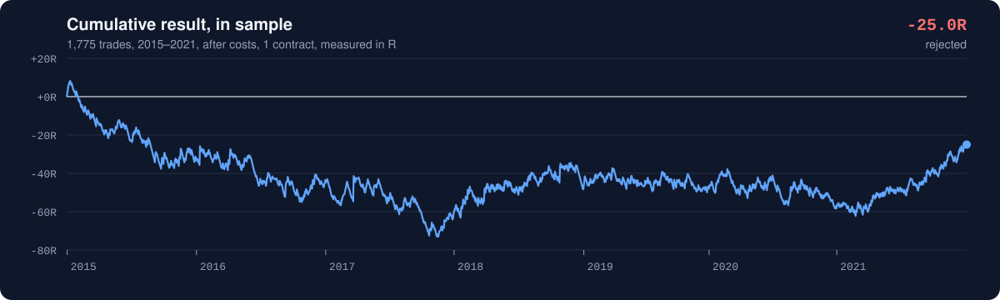
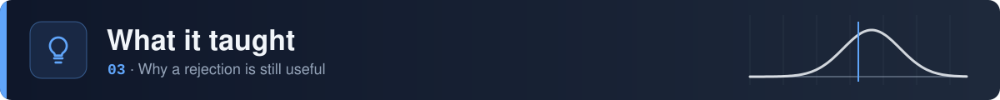
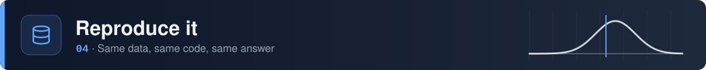

<picture>
  <source media="(prefers-color-scheme: dark)" srcset="./assets/banner-dark.svg" />
  <source media="(prefers-color-scheme: light)" srcset="./assets/banner-light.svg" />
  
</picture>

<br>

<div align="center">
  
  
  
  
  
</div>

<br>

One hypothesis from [the NQ Lab book](https://github.com/nqedgelab/nq-research), tested on its own terms: rules fixed before the test, costs included, and a verdict whichever way it went.

> [!IMPORTANT]
> **Rejected.** No measurable edge before costs (+0.024R) or after (−0.014R). The validation and holdout years were never used, so they stay clean for the next idea.

<br>

<picture>
  <source media="(prefers-color-scheme: dark)" srcset="./assets/section-claim-dark.svg" />
  <source media="(prefers-color-scheme: light)" srcset="./assets/section-claim-light.svg" />
  
</picture>

**Claim.** Trading in the direction of the first 1-minute close outside the 09:30–09:45 ET range, with the stop at the other side of the range and an exit at the end of the session, has positive expectancy after costs.

<div align="center">

| Rule | Setting |
|:---|:---|
| Range | High and low of the 09:30–09:44 bars. Skip the day if any bar is missing. |
| Signal | First close above the high (long) or below the low (short), before 12:00 |
| Entry | Open of the next bar |
| Stop | Other side of the range; a gap past it fills at the bar's open |
| Exit | Last regular-hours bar of the session |
| Costs | 0.25 pt commission, 1 tick slippage in and out, 2 ticks on stops |
| Filters | None. One trade a day, 1 contract. |

</div>

The full write-up, including the case against the idea, is in [`hypothesis.md`](hypothesis.md). It was committed before any test, and that commit is the first one in this repo's history.

<br>

<picture>
  <source media="(prefers-color-scheme: dark)" srcset="./assets/section-result-dark.svg" />
  <source media="(prefers-color-scheme: light)" srcset="./assets/section-result-light.svg" />
  
</picture>

<picture>
  <source media="(prefers-color-scheme: dark)" srcset="./assets/equity-dark.svg" />
  <source media="(prefers-color-scheme: light)" srcset="./assets/equity-light.svg" />
  
</picture>

<div align="center">

| Trades | Win rate | Avg win | Avg loss | Expectancy | 95% CI | Before costs |
|:---:|:---:|:---:|:---:|:---:|:---:|:---:|
| 1,775 | 39.2% | 1.38R | 0.91R | **−0.014R** | −0.078 to +0.051 | +0.024R |

</div>

To pass, expectancy needed to be above zero with the low end of its confidence interval above zero too. Neither held. Breakdowns by direction, year, range width and roll weeks are in [`results.md`](results.md); every one of them includes zero.

<br>

<picture>
  <source media="(prefers-color-scheme: dark)" srcset="./assets/section-lessons-dark.svg" />
  <source media="(prefers-color-scheme: light)" srcset="./assets/section-lessons-light.svg" />
  
</picture>

- **Costs weren't the problem.** With a median risk of 28 points, costs were only about 0.03R a trade. There was no edge for them to eat.
- **Payoff and win rate cancelled out.** Wins were 1.5 times the size of losses but came only 39% of the time.
- **The breakdowns are bait.** Longs (+0.04R) and 2021 (+0.13R) look better, but with 17 groups about one should look good by chance. Longs doing better also matches a market that mostly rose. Any follow-up built on them must be a new hypothesis, first tested on the validation years.
- **A big drawdown proves nothing by itself.** The 81R drawdown is what a strategy with no edge and a 1R stop does over 1,775 trades.

<br>

<picture>
  <source media="(prefers-color-scheme: dark)" srcset="./assets/section-data-dark.svg" />
  <source media="(prefers-color-scheme: light)" srcset="./assets/section-data-light.svg" />
  
</picture>

```bash
pip install -r requirements.txt      # installs nqlab v0.1.0 from the book
python -m pytest                     # 8 tests, one per trading rule
python backtest/h001.py in_sample    # needs NQ_DATA_DIR in a .env file
```

Market data is licensed and isn't in the repo, and neither is the trade list derived from it. `nqlab` is pinned to a tagged version, so later changes to the shared loader can't quietly change this result.

<details>
<summary><b>What's in the repo</b></summary>
<br>

```
nq-h001-opening-range/
├── hypothesis.md       the claim, rules and rejection criteria, written first
├── results.md          full results and breakdowns
├── backtest/
│   ├── h001.py         the backtest
│   └── test_h001.py    one test per trading rule
└── assets/             README artwork and the script that draws it
```

</details>

<br>

<p align="center">
  <sub>Part of <a href="https://github.com/nqedgelab/nq-research">the NQ Lab book</a> · paper traded · not financial advice</sub>
</p>


